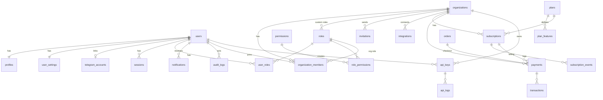
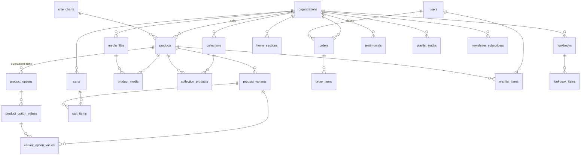

# Архитектура платформы

Рабочее название в коде — `platform` (пакеты `@repo/*`). Бренд платформы задаётся позже.

## 1. Продукт

**SaaS для брендов одежды.** Бренд (организация) оформляет подписку и получает:

- витрину магазина в стиле референса (веб + Telegram Mini App);
- кабинет: товары, коллекции, заказы, контент главной, лукбук, плейлист, команда, API-ключи, тариф;
- покупатели оформляют заказы на витрине бренда.

| Актор | Где работает | Роль |
|---|---|---|
| Сотрудник платформы | `/admin` | `SUPER_ADMIN`, `ADMIN`, `MANAGER` (платформенные) |
| Владелец / сотрудник бренда | `/dashboard/[org]` | `ORG_OWNER`, `ORG_ADMIN`, `ORG_MANAGER`, `ORG_STAFF` + кастомные роли бренда |
| Покупатель | витрина, Mini App, `/account` | `USER` |
| Интеграция бренда | REST API по ключу | `API_CLIENT` (права ключа ⊆ прав создателя) |

### Допущения (действуют, пока не уточнены)

| # | Допущение | Где меняется |
|---|---|---|
| D1 | Платёжный провайдер не выбран → `SandboxPaymentProvider`, явно помечен как SANDBOX, реальные деньги не проводит | `apps/api/src/modules/payments/providers` |
| D2 | Деньги покупателя идут **напрямую бренду**: бренд подключает свой платёжный аккаунт (ключи хранятся зашифрованными). Подписку бренд платит платформе | `integrations` |
| D3 | Каждый бренд подключает **своего** Telegram-бота; `initData` проверяется токеном бота этого бренда | `integrations` |
| D4 | Суммы — целые числа в минорных единицах (`amount_minor`), валюта ISO 4217 на уровне бренда | везде |
| D5 | Интерфейс кабинетов — RU; тексты витрины — контент бренда | `apps/web` |
| D6 | Рекомендация размера («Find my size») — простая серверная эвристика по таблице размеров товара | `catalog` |

## 2. Monorepo

```
apps/
  api/          NestJS 12 (ESM) — REST /api/v1, Swagger /api/docs
  web/          Next.js 16 — лендинг+тарифы, auth, /account, /dashboard/[org], /admin, витрины /s/[store]
  mini-app/     Next.js 16 — витрина в Telegram (/[store])
packages/
  shared/       Zod-схемы, DTO-типы, коды прав и фич — единый контракт фронт↔бэк
  ui/           дизайн-система: tokens.css (light/dark), компоненты (shadcn/ui в стиле референса)
  config/       tsconfig-база
infrastructure/ docker-compose (Postgres, Redis), Dockerfile'ы, конфиги окружений
docs/           анализ, архитектура, деплой
```

Менеджер — pnpm 12 (через corepack), версии фиксируются в `pnpm-lock.yaml`.
TypeScript 6.0 во всём репозитории (NestJS CLI 12 собирается на TS 6; TS 7 пока не используем).

## 3. Backend (`apps/api`)

```
src/
  main.ts                    bootstrap: префикс /api, версия v1, CORS, Swagger
  config/                    валидация env (Zod) — приложение не стартует с неверным env
  common/                    guards, decorators, interceptors, filters, pagination, crypto
  infra/                     prisma, redis, queue (BullMQ), storage, mail
  modules/
    auth/                    проверка токенов Supabase, сессии, отзыв
    users/  profiles/  settings/  sessions/  activity/   (audit_logs)
    rbac/                    roles, permissions
    organizations/           members, invitations
    plans/  subscriptions/   SubscriptionGuard, лимиты
    payments/                PaymentProvider, webhooks, transactions
    api-keys/                выдача, отзыв, логи
    telegram/                initData, бот, привязка
    catalog/                 products, variants, collections, size charts, media
    commerce/                cart, orders, wishlist
    content/                 home sections, lookbook, testimonials, playlist, newsletter
    admin/                   статистика, системные события, настройки платформы
    notifications/
```

Каждый модуль: `controller` (HTTP + Swagger + DTO) → `service` (бизнес-логика) → Prisma.
Контроллер не содержит логики; сервис не знает про HTTP.

### 3.1 Конвейер запроса

```
ThrottlerGuard → AuthGuard → TenantGuard → PermissionsGuard → SubscriptionGuard → ValidationPipe(Zod) → Controller
                                                          ↓ ошибки
                                    AllExceptionsFilter (единый формат ошибки, без утечек стектрейса)
Interceptors: RequestId, AuditLog (для мутаций), ApiKeyLog, Serialize
```

- **AuthGuard** принимает один из трёх видов учётных данных:
  1. `Authorization: Bearer <Supabase JWT>` — проверка подписи через JWKS проекта Supabase (`jose`), `iss`, `aud`, `exp`; затем поиск пользователя по `supabase_id`, проверка статуса (BLOCKED → 403) и отзыва сессии (`session_id` в deny-list Redis).
  2. `Authorization: Bearer <platform JWT>` — наш токен сессии Telegram (подписан `JWT_SECRET`, 15 мин).
  3. `X-API-Key: <prefix>.<secret>` — поиск по префиксу, сравнение SHA-256 хеша за постоянное время, проверка `revoked_at`/`expires_at`, отдельный rate limit ключа.
- **TenantGuard**: организация берётся **только из маршрута** (`/organizations/:orgId/...`), проверяется членство пользователя (или принадлежность API-ключа). В `request.tenant` кладётся `{ organizationId, memberRoleId }`.
- **PermissionsGuard**: `@RequirePermissions('products.write')`. Права = права платформенных ролей ∪ права роли в организации. `SUPER_ADMIN` — все права. Набор прав кэшируется в Redis (сброс при изменении ролей).
- **SubscriptionGuard**: `@RequireFeature('telegram_mini_app')`, `@CheckLimit('products.max')` — читает активную подписку организации и `plan_features` на сервере.

### 3.2 Изоляция организаций (anti-IDOR)

- Все бизнес-таблицы бренда содержат `organization_id`.
- Сервисы получают `organizationId` из `request.tenant`, **никогда** из тела запроса.
- Любой поиск по id выполняется как `where: { id, organizationId }`; «не найдено» и «чужое» дают одинаковый 404.
- Тесты: для каждого ресурса — попытка доступа пользователем другой организации.
- Таблицы живут в схеме Postgres `app`, которая **не публикуется** через Data API Supabase; фронтенд ходит в Supabase только за Auth.

### 3.3 Авторизация

**Веб (Supabase Auth):** регистрация, подтверждение email, вход, восстановление пароля выполняет Supabase Auth на фронте (`@supabase/supabase-js`). Бэкенд при первом запросе с валидным JWT создаёт `users`/`profiles` (upsert по `supabase_id`).
Сессии: `session_id` из JWT фиксируется в `sessions`; «выйти на устройстве» = запись в deny-list + `revoked_at`. Блокировка пользователя действует немедленно (проверка статуса в AuthGuard, кэш 60 с).

**Telegram Mini App:**

```
Mini App ──initData──▶ POST /api/v1/telegram/auth {initData, store}
  1. бот бренда по store → токен из integrations (расшифровка в памяти)
  2. secret = HMAC_SHA256(key="WebAppData", msg=bot_token)
     hash' = HMAC_SHA256(key=secret, msg=data_check_string)  // пары key=value без hash, сортировка, \n
     timingSafeEqual(hash, hash')
  3. now - auth_date ≤ TELEGRAM_INITDATA_MAX_AGE (600 с)
  4. Redis SET tg:initdata:<hash> NX EX 600 → повтор = 401
  5. upsert telegram_accounts(telegram_id) → users
  6. выдача access JWT (15 мин) + refresh (хеш в sessions, ротация)
```

Токен бота никогда не покидает сервер. Привязка к веб-аккаунту: залогиненный пользователь получает одноразовый код (Redis, 10 мин) → открывает `t.me/<bot>?startapp=link_<code>` → Mini App передаёт код вместе с `initData`.

**API-ключи:** `pk_<prefix>.<secret>`, секрет — 32 байта `crypto.randomBytes`, в БД только SHA-256 хеш и префикс. Полный ключ показывается один раз. Логгер маскирует заголовки `authorization`, `x-api-key`, `cookie`.

### 3.4 Подписки

- `plans` + `plan_features(feature_key, enabled, limit_value)` редактируются в админке; коды фич — константы в `@repo/shared`.
- Статусы: `TRIALING → ACTIVE → PAST_DUE → CANCELED | EXPIRED`. Одна «живая» подписка на организацию (частичный уникальный индекс).
- Смена тарифа: апгрейд — сразу (после оплаты), даунгрейд — с конца периода, с проверкой, что текущее использование влезает в лимиты нового тарифа.
- Истечение/продление — задачи BullMQ по расписанию; каждое изменение пишется в `subscription_events`.
- Free-тариф создаётся организации автоматически.

### 3.5 Платежи

```ts
interface PaymentProvider {
  readonly code: string;          // 'sandbox', ...
  createPayment(input): Promise<{ providerPaymentId; status; confirmationUrl? }>;
  getStatus(providerPaymentId): Promise<PaymentStatus>;
  refund?(providerPaymentId, amountMinor): Promise<RefundResult>;
  verifyWebhook(rawBody: Buffer, headers): Promise<WebhookEvent>;   // бросает при неверной подписи
}
```

- Создание платежа требует `Idempotency-Key`; повтор с тем же ключом возвращает сохранённый ответ (`idempotency_keys`).
- Webhook: raw body → `verifyWebhook` → `INSERT webhook_events (provider, event_id)` с уникальным индексом → при конфликте 200 без обработки → обработка в транзакции (payment → transaction → subscription/order) → `processed_at`.
- Статус платежа меняется только по webhook или по `getStatus` провайдера, **никогда** по данным фронтенда.

## 4. Frontend

### `apps/web` — маршруты

| Маршрут | Назначение | Источник дизайна |
|---|---|---|
| `/` , `/pricing` | лендинг платформы, тарифы | своя система |
| `/login` `/register` `/forgot-password` `/reset-password` `/auth/callback` | Supabase Auth | своя система |
| `/account/*` | профиль, настройки, заказы, сессии, история, Telegram, удаление | своя система |
| `/dashboard/[org]/*` | кабинет бренда (боковая навигация) | своя система |
| `/admin/*` | админка платформы | своя система |
| `/s/[store]/*` | витрина: главная, коллекция, товар, лукбук, поиск, избранное, checkout | **референс** |

Витрина на поддомене `{store}.<домен>` переписывается на `/s/[store]` на уровне Next (proxy/middleware) — уточнить API в доках Next 16 на этапе 3.

Данные: TanStack Query (клиент) + серверные компоненты для витрины (SEO). Формы: React Hook Form + Zod-схемы из `@repo/shared`.

### `apps/mini-app`

Та же витрина (компоненты из `@repo/ui`), маршрут `/[store]`. Telegram SDK: `ready()`, `expand()`, `themeParams` → CSS-переменные токенов, `BackButton` (история навигации), `MainButton` («В корзину» / «Оформить»), `viewport` safe areas.

## 5. ER-модель

Все таблицы: `id uuid PK`, `created_at`, `updated_at` (кроме связочных). Схема `app`.





Ключевые ограничения (полностью — в Prisma-схеме на этапе 4):

| Таблица | Уникальность / индексы |
|---|---|
| `users` | `supabase_id` UQ, `email` UQ (nullable), `status` idx |
| `telegram_accounts` | `telegram_id` UQ, `user_id` UQ |
| `sessions` | `refresh_token_hash` UQ, `supabase_session_id` UQ, (`user_id`, `revoked_at`) |
| `roles` | (`organization_id`, `key`) UQ; `organization_id IS NULL` — системные |
| `permissions` | `key` UQ |
| `organizations` | `slug` UQ, `custom_domain` UQ |
| `organization_members` | (`organization_id`, `user_id`) UQ |
| `invitations` | `token_hash` UQ, (`organization_id`, `email`) |
| `integrations` | (`organization_id`, `kind`, `provider`) UQ; `config_encrypted` (AES-256-GCM) |
| `plans` / `plan_features` | `code` UQ / (`plan_id`, `feature_key`) UQ |
| `subscriptions` | частичный UQ (`organization_id`) WHERE status IN (TRIALING, ACTIVE, PAST_DUE) |
| `payments` | (`provider`, `provider_payment_id`) UQ, `idempotency_key` UQ |
| `webhook_events` | (`provider`, `event_id`) UQ |
| `api_keys` | `prefix` UQ, `key_hash` UQ |
| `api_logs` | (`api_key_id`, `created_at`) |
| `audit_logs` | (`organization_id`, `created_at`), (`actor_user_id`, `created_at`) |
| `products` / `collections` | (`organization_id`, `slug`) UQ |
| `product_variants` | (`organization_id`, `sku`) UQ |
| `orders` | (`organization_id`, `number`) UQ, (`user_id`, `created_at`) |
| `cart_items` | (`cart_id`, `variant_id`) UQ |
| `wishlist_items` | PK (`user_id`, `product_id`) |
| `newsletter_subscribers` | (`organization_id`, `email`) UQ |

## 6. Окружения и деплой

| Компонент | dev | staging / production |
|---|---|---|
| web, mini-app | `next dev` | Vercel (2 проекта) |
| api | `nest start --watch` | Docker-контейнер на облачном Node-хостинге (Render / Railway / Fly.io) |
| PostgreSQL | docker-compose или Supabase (dev-проект) | Supabase (отдельные проекты staging/prod), pooler для рантайма, direct URL для миграций |
| Redis | docker-compose | управляемый Redis (TLS) |
| Файлы | локальная папка | Supabase Storage (загрузка через API, signed URLs, проверка MIME/размера) |
| Auth | Supabase dev-проект | Supabase staging/prod |

Секреты — только в переменных окружения; в репозитории лишь `.env.example`.

## 7. Тестирование

- **Unit (vitest):** проверка `initData`, хеширование ключей, вычисление прав, лимиты тарифов, переходы статусов подписки, идемпотентность webhook.
- **API/integration (vitest + supertest, реальный Postgres):** auth, RBAC-матрица, изоляция организаций, API-ключи, webhook-повторы.
- **E2E (Playwright):** регистрация → создание бренда → товар → заказ на витрине → sandbox-оплата.
